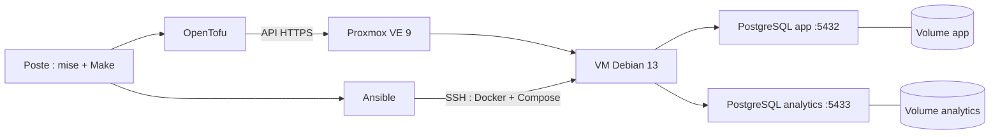

# iac-postgres

**Une VM dédiée à PostgreSQL dans le homelab, pour les applications et le développement.**

[Installation](docs/installation.md) · [Architecture](docs/architecture.md) ·
[Décisions techniques](docs/adr/README.md) · [Dépendances](DEPENDENCIES.md) · [Sécurité](docs/securite.md) ·
[Travaux prévus](TODO.md)

iac-postgres automatise le déploiement d'une VM sur Proxmox et le provisionnement
des instances PostgreSQL qu'elle héberge. L'objectif est de fournir des bases aux
applications du homelab et de créer facilement des bases de test pour le
développement, depuis des fichiers de configuration.

L'infrastructure est commune : une seule VM héberge plusieurs instances PostgreSQL.
Chaque application ou environnement de développement peut disposer de sa propre
instance, avec sa base initiale, son utilisateur et son port de connexion.

## Usages

- Fournir une base PostgreSQL à une nouvelle application du homelab.
- Créer une base de test pour développer ou expérimenter sans utiliser les données
  de l'application habituelle.
- Faire cohabiter plusieurs projets ou environnements sur la même VM, avec des
  conteneurs et des volumes de données distincts.
- Décrire les instances souhaitées dans un fichier et réappliquer leur configuration
  depuis le poste de travail.

## Fonctionnement



Les ports et noms illustrent [la configuration d'exemple](databases.yml.example).
Les [schémas détaillés](docs/architecture.md) présentent les flux de gestion,
les accès applicatifs et les limites de cette architecture.

| Étape | Outil | Rôle |
| --- | --- | --- |
| Provisionner la VM | OpenTofu | Créer la VM Debian 13 sur Proxmox VE 9, avec ses ressources et sa configuration réseau |
| Préparer le système | Ansible | Configurer la VM et installer Docker et Compose |
| Déployer PostgreSQL | Docker Compose, piloté par Ansible | Démarrer une instance PostgreSQL 17 sur Alpine par entrée déclarée |
| Exécuter les opérations | mise et Make | Fournir les versions des outils et les commandes du projet |

Deux fichiers décrivent le déploiement :

- `terraform/terraform.tfvars` : accès Proxmox, ressources de la VM, réseau et clé SSH.
- `databases.yml` : instances à provisionner, avec leur identifiant, leur base,
  leur utilisateur, leur mot de passe et leur port.

Chaque entrée de `databases.yml` correspond à une **instance PostgreSQL distincte**,
avec son conteneur, son réseau Docker et son volume de données. Les applications
s'y connectent avec l'adresse IP de la VM et le port choisi pour leur instance.

## Prise en main

Pour commencer, suivre le [guide d'installation](docs/installation.md) :
préparer les outils, les accès Proxmox et les deux fichiers de configuration,
puis vérifier le plan avant le premier déploiement. Les contrôles du dépôt
peuvent être exécutés sans accès à Proxmox :

```sh
mise trust
mise install --locked
make check
make security
```

Le premier déploiement prépare la VM et les instances déclarées. Pour ajouter
ensuite une instance destinée à une application ou à des tests, il suffit de
compléter `databases.yml`, de vérifier la configuration et de lancer
`make configure` sur la VM existante.

`make status` permet de consulter l'état et les ports des conteneurs.
Les changements de ressources ou de réseau de la VM passent par OpenTofu.

Le [guide d'utilisation](docs/utilisation.md) détaille les commandes, l'ajout
d'une instance et la connexion à une base.

## Commandes pratiques et contrôles

```sh
source scripts/auth.sh   # Terminal Bash : saisir le token Proxmox sans bloc à copier
make check              # Validations, tests et lint
make security           # Gitleaks et Trivy, mode local strict
make clear              # Archiver les fichiers générés et le state dans ./tmp/
make restore            # Lister les archives et afficher la commande de restauration
make clear-tmp          # Supprimer les archives, avec protection du state
```

La [maintenance](docs/maintenance.md#nettoyage-et-restauration) explique la
restauration et les protections du state. Les workflows GitHub contrôlent la
qualité et la sécurité sans accéder à Proxmox. Le [guide de vérification](docs/verification.md)
décrit la CI, les versions et les limites des contrôles.

## Données et cycle de vie

Les volumes conservent les données lors d'une recréation des conteneurs. Toutes les
instances partagent toutefois les ressources et le disque de la VM : supprimer ou
remplacer cette VM peut entraîner la perte de leurs données.

Retirer une entrée de `databases.yml` laisse l'instance existante en place ; sa
suppression reste manuelle. Les paramètres de base, d'utilisateur et de mot de
passe servent à l'initialisation et ne modifient pas une base déjà initialisée.
Ces comportements sont détaillés dans la [configuration](docs/configuration.md#effet-des-changements).

Le projet ne fournit pas de sauvegarde automatique, de haute disponibilité,
de TLS PostgreSQL ni de supervision intégrée.
L'utilisateur PostgreSQL initial est un superutilisateur de son instance ;
aucun rôle applicatif à droits réduits n'est créé automatiquement.
Les évolutions envisagées sont suivies dans [TODO.md](TODO.md).

## Organisation

| Chemin | Rôle |
| --- | --- |
| `terraform/` | Infrastructure Proxmox gérée par OpenTofu |
| `ansible/` | Installation Docker et déploiement PostgreSQL |
| `scripts/` | Préparation des fichiers locaux, inventaire et réutilisation de l'image Debian |
| `tests/` | Tests des scripts et de la validation des configurations |
| `docs/` | Guides d'installation, d'utilisation et de maintenance |
| `docs/adr/` | Décisions d'architecture de la v1 |
| `DEPENDENCIES.md` | Outils, composants déployés, services externes et versions |
| `TODO.md` | Évolutions envisagées après la v1 |
| `dependencies.json`, `mise.lock`, `.mise/locks/` | Références d'images, empreintes des outils et graphes Python verrouillés |
| `Makefile`, `mise.toml` | Commandes du projet et versions des outils |
| `databases.yml.example` | Modèle de configuration des instances |

## Documentation

| Guide | Contenu |
| --- | --- |
| [Installation](docs/installation.md) | Prérequis, préparation du poste et premier déploiement |
| [Accès Proxmox](docs/proxmox.md) | Token API et permissions nécessaires |
| [Configuration](docs/configuration.md) | Paramètres de la VM et des instances PostgreSQL |
| [Utilisation](docs/utilisation.md) | Commandes, ajout d'instances et connexion aux bases |
| [Maintenance](docs/maintenance.md) | State OpenTofu, fichiers générés et vérifications |
| [Dépannage](docs/depannage.md) | Diagnostic des problèmes courants |
| [Vérification](docs/verification.md) | Versions, contrôles GitHub et limites de validation |
| [Architecture](docs/architecture.md) | Schémas Mermaid, responsabilités et cycle de vie |
| [ADR](docs/adr/README.md) | Choix techniques, alternatives et compromis |
| [Dépendances](DEPENDENCIES.md) | Inventaire détaillé et limites de reproductibilité |

L'[index de la documentation](docs/README.md) propose un parcours pour démarrer.

La CI conserve les [risques connus acceptés](docs/securite.md) dans ses rapports.
Une [veille quotidienne avec notification Discord](docs/verification.md#notifications-discord-des-correctifs)
signale les nouvelles versions stables d’OpenTofu et du provider Proxmox, ainsi
que les correctifs confirmés.

## Auteur et licence

Projet de [Camille Bennazar](https://github.com/camille-bennazar), distribué sous
[licence MIT](LICENSE). Les composants tiers conservent leurs propres licences.
