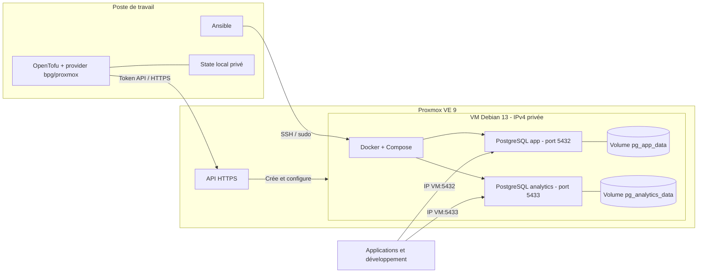
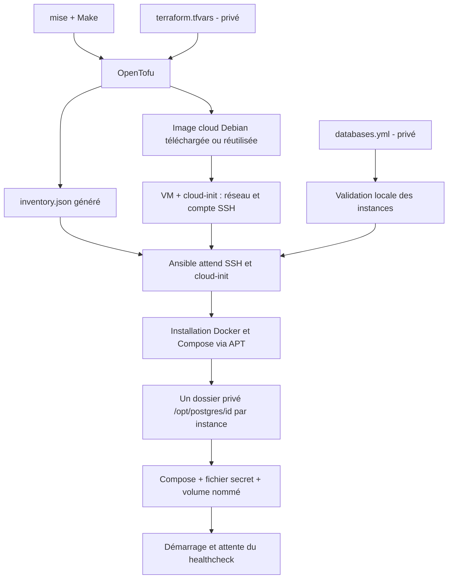

# Architecture de la v1

[Documentation](README.md) · [Décisions d'architecture](adr/README.md)

## Vue d'ensemble

Une VM Debian héberge plusieurs instances PostgreSQL. Les outils de gestion
s'exécutent sur le poste ; les applications se connectent directement aux ports
SQL de la VM. Les noms `app` et `analytics` et les ports ci-dessous sont les
valeurs de l'exemple, pas une contrainte du projet.

Les réseaux Docker sont distincts par instance, mais les ports sont publiés sur
l'IP de la VM. Le filtrage réseau dépend de Proxmox ou du réseau environnant.
Les volumes sont sur le disque de cette même VM : ce schéma ne comporte ni
réplication ni sauvegarde externe automatique.

## Chaîne de déploiement

Avant `plan` et `apply`, le script de préparation recherche aussi l'image sur
Proxmox et refuse un fichier présent mais non suivi. Aucun import automatique
n'est réalisé. Les références d'images et leurs empreintes sont déclarées dans
[dependencies.json](../dependencies.json). Le détail
est dans la [maintenance de l'image](maintenance.md#image-debian).

## Frontières et cycle de vie

| Couche | Responsabilité | Limite |
| --- | --- | --- |
| OpenTofu | Image, VM, ressources et configuration cloud-init initiale | Une destruction ou un remplacement de VM menace toutes ses données |
| Ansible | Validation, paquets, fichiers et exécution de Compose | Ne retire pas les instances absentes du YAML |
| Compose | Conteneur, réseau, volume et santé par instance | Pas de cluster ni de haute disponibilité |
| Image PostgreSQL | Initialisation de la base et du superutilisateur | Les paramètres initiaux ne modifient pas une base déjà initialisée |
| Opérateur | Sauvegardes, accès réseau, mises à jour et restauration | Ces opérations ne sont pas automatisées dans la v1 |

`configure` suffit pour ajouter une instance sur la VM existante. Une modification
de ressources passe par `plan` puis `apply`. Les volumes survivent à la recréation
des conteneurs, mais pas à la perte de leur disque. Aucun quota CPU ou RAM par
instance n'est défini. Le mot de passe est fourni par un secret Compose en fichier,
sans chiffrement automatique au repos ni rotation SQL intégrée.

## Vérification et décisions

La CI teste les configurations et les scripts sans connexion à Proxmox. Elle ne
valide pas un déploiement réel ni la restauration des données. La
[recette manuelle](maintenance.md#vérification-sur-un-environnement-de-test)
complète ces contrôles.

Les [ADR](adr/README.md) expliquent les choix actuels ; les
[dépendances](../DEPENDENCIES.md) décrivent leurs versions et sources ;
[TODO.md](../TODO.md) recense les améliorations envisagées.

## Image PostgreSQL

Les conteneurs utilisent l'image officielle PostgreSQL 17 sur Alpine Linux 3.24,
épinglée par digest dans `dependencies.json`. La VM hôte utilise Debian 13.
Alpine utilise musl : valider les locales, collations et extensions nécessaires
pendant la recette. Les [risques connus](securite.md) décrivent les alertes et
exceptions de l'image et des outils.
